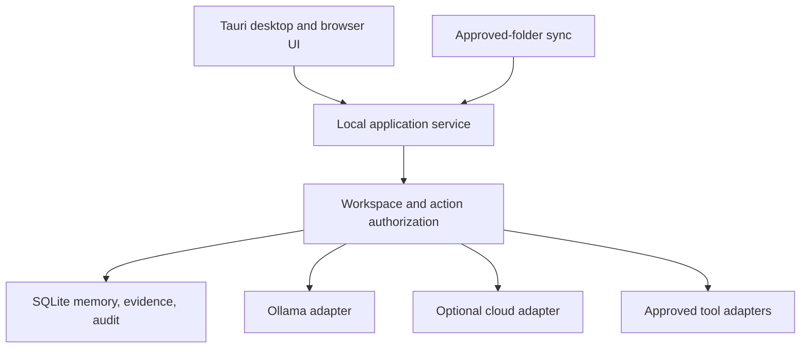

# Jarvis 2.0 — Proposed Architecture

**Status:** the logical product architecture below remains proposed. The merged baseline implements local SQLite storage/permissions, approved-folder ingestion, document FTS5 retrieval and M01-D memory lifecycle. M01-E is reviewing cross-service acceptance. No desktop, dashboard, model, voice or external integration is implemented.

## 1. Architecture goals

- Run the memory and basic retrieval path locally without cloud access.
- Keep user data, workspace authorization, and action approvals under application control.
- Allow desktop and browser clients to share the same application services.
- Add models and tools behind explicit interfaces rather than making them authoritative over data or permissions.
- Keep optional features removable and avoid mandatory paid services.

## 2. Proposed logical components

| Component | Responsibility | Trust boundary |
|---|---|---|
| Desktop shell | Windows windowing, app lifecycle, controlled native capabilities | OS boundary; only explicitly granted native capabilities |
| Dashboard UI | Search, evidence review, workspace selection, approvals, settings, galaxy visualization | Untrusted presentation client; not the authorization authority |
| Local application service | API, authentication/session handling, orchestration, permission checks, audit events | Trusted policy enforcement point |
| Memory and evidence store | SQLite database, migrations, FTS search, evidence/source metadata, tombstones | Local user data boundary |
| Approved-folder sync | Watch or scan configured roots, normalize paths, record provenance, report sync state | File access limited to revocable approved roots |
| Model adapters | Ollama first; optional cloud adapters behind explicit routing and data-sharing controls | Model providers receive only the data approved for a request |
| Tool adapters | MCP/API, GitHub/OpenCode, browser automation, REA, and future agents | Each adapter has a narrow capability and approval policy |
| Background workers | Sync, indexing, speech, and later bounded tasks | No implicit permission expansion or unlogged side effects |

### Provisional implementation direction

A candidate is a Tauri 2 Windows shell with a TypeScript web UI and a Python local service. The service would expose a versioned loopback API and use Python's SQLite interface. This is a **proposal**, not a locked stack decision: it needs a small compatibility spike and should be compared against a single-process alternative before desktop implementation begins.

The browser dashboard can use the same UI and API. If it runs in an ordinary browser, it should be loopback-only, use a short-lived local session/CSRF defense, reject arbitrary remote origins, and never expose a wildcard CORS policy. Tauri capabilities should be narrowly scoped by window and command.

## 3. Data flow

1. The user chooses a workspace and asks a question or initiates a sync.
2. The application service authenticates the local client and resolves its workspace/action scope.
3. Retrieval queries only authorized workspace data and returns evidence IDs, source metadata, and permission-safe content.
4. If a model is used, the routing policy selects local Ollama by default. Cloud routing requires a separate user setting and request-level data-sharing permission.
5. The answer retains citations to evidence and indicates uncertainty or missing evidence.
6. A proposed memory is staged for review. Permanent insertion occurs only after explicit approval.
7. External tool calls and changes use the relevant connector policy and require approval unless a future reviewed policy explicitly grants a narrow, bounded action.

## 4. Workspace and permission model

- Every memory, evidence record, source, sync job, and audit event is associated with a workspace.
- Personal and project workspace identifiers are not interchangeable.
- Retrieval APIs require a workspace context and apply access checks in the service before returning data.
- Cross-workspace retrieval is denied by default; an explicit user approval grants only the requested scope and should be visible in the audit trail.
- Folder permissions are granted per selected root, not per drive or user home by default.
- Connectors receive only the workspace and capability needed for the specific operation.
- System prompts and frontend hiding are not security controls.

## 5. Memory lifecycle

**M01-D implementation:** a pending candidate is bound to its content digest, evidence digest, workspace and revision. Approval requires a short-lived signed `DecisionContext` issued by a trusted host and validated in the storage service. Approved memories preserve workspace and evidence snapshots, revisions, and soft-delete state. Purge is a separate manager-authorized, signed operation that cascades active evidence and revision rows.

The signing context verifies that a trusted host issued a decision for the exact reviewed snapshot. It does not independently authenticate the actor or prove a human clicked. An eventual UI/host must authenticate the user, render the snapshot, and guard access to the signing key. The database remains application-level authorization, not a security boundary against a user who can edit the file.

- A candidate is not permanent memory.
- The approval record records the candidate, evidence links, workspace, and decision time.
- Soft deletion removes an item from ordinary search while retaining enough metadata to restore it.
- Purge is a separate, clearly labeled operation and must also address indexes, caches, and generated derivatives.
- Folder sync records source identity and last-seen/version state; source removal must not silently hard-delete approved memories.

## 6. Local model and cloud boundary

- Ollama is the initial local inference candidate; availability, model terms, language quality, and performance must be tested on the target hardware.
- A model adapter cannot grant itself database, filesystem, network, or connector permissions.
- Treat model output, tool arguments, and retrieved text as untrusted.
- Cloud model routing is opt-in, shows which provider may receive content, and should support per-request exclusion/redaction.
- Model files and model licenses are distinct from Ollama's software license. Record each model's exact revision, terms, and memory requirements before use.

## 7. Integration and execution boundaries

- MCP/API tools are treated as external capabilities. Validate input/output schemas and authorize each call centrally.
- Keep local MCP servers on stdio where practical. A network transport requires authentication, origin restrictions, and a separate threat review.
- GitHub/OpenCode integration should begin read-only or draft-based where possible; write operations require explicit confirmation.
- Browser automation runs in a dedicated profile/context with an allowlist and user-visible approval for consequential actions.
- REA is reserved for legally authorized targets, isolated workspaces, explicit target selection, and an auditable analysis record.
- Coding agents operate in a repository worktree or similarly scoped workspace; file, shell, network, and subagent capabilities are separately controlled.
- Future Mission Mode must have named objective, allowed tools, data/workspace scope, time/action budget, stop conditions, dry-run or preview, and a human stop control.

## 8. Security and privacy requirements for implementation

- Bind the local service to loopback by default. Do not assume a local port is secret or trusted.
- Use per-install random session tokens or equivalent protection for browser clients; protect against cross-site requests and hostile origins.
- Store secrets using Windows credential storage or an equivalent protected mechanism; never commit credentials or place them in logs.
- Validate and canonicalize approved paths; handle junctions/symlinks, path traversal, archive expansion, and file replacement races.
- Treat imported content as untrusted and inert. Never execute code found in synced folders.
- Pin dependencies and external tools; record hashes/signatures where supported; review security advisories before upgrades.
- Limit logs to necessary metadata and provide a redaction/export policy.
- Back up before migrations and test restore, deletion, and permission isolation.
- No security property is considered verified until exercised by implementation-specific tests/review.

## 9. Proposed component diagram

The diagram is a target shape, not a statement that these processes exist today.
