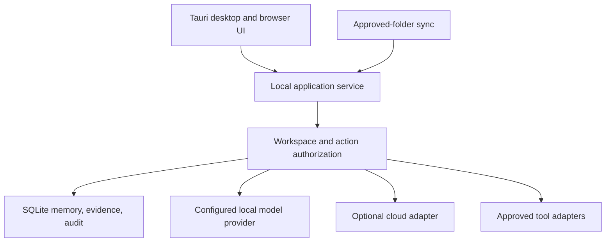

# Jarvis 2.0 — Proposed Architecture

**Status:** the logical product architecture below remains proposed. `main` includes M01-A through M01-E, M02-A through M02-D, Q01, M03-A, P2-A1 through A4, the partial P3 Developer Intelligence slice, and M08-A through M08-C. This feature branch implements M08-D reliability. The product remains a loopback development alpha, not a production multi-user service or autonomous coding agent. P2 live owner acceptance remains open. See [P2 acceptance](P2_FINAL_ENGINEERING_ACCEPTANCE.md), [P3 implementation and limits](P3_DEVELOPER_INTELLIGENCE.md), [M03-B2](M03B2_LOCAL_PROVIDER.md), [P2-A4](P2A4_CONNECTED_UI.md), [M08-B planning](M08B_MISSION_PLANNING.md), [M08-C implementation and acceptance](M08C_IMPLEMENTATION.md), and [M08-D implementation and acceptance](M08D_IMPLEMENTATION.md).

M08-A is merged to `main` via PR #24. M08-B is merged to `main` at
`debea200e0c9e205ff54e00ab290a2098b72d9f3`; M08-C was merged through PR #26
at `eca012ace5c1247d682c1821cef1598a5f8d5578`. This feature branch adds M08-D
reliability. These milestones do not create an autonomous coding agent. Python is the primary
development language. Independent local Python coding is a future goal;
external coding agents are optional integrations. Dedicated Java and other
language support is deferred.

## 1. Architecture goals

- Run the memory and basic retrieval path locally without cloud access.
- Keep user data, workspace authorization, and action approvals under application control.
- Allow desktop and browser clients to share the same application services.
- Add models and tools behind explicit interfaces rather than making them authoritative over data or permissions.
- Keep optional features removable and avoid mandatory paid services.

## 2. Proposed logical components

| Component | Responsibility | Trust boundary |
|---|---|---|
| Desktop shell | Windows windowing, app lifecycle, controlled native capabilities | OS boundary; only explicitly granted native capabilities |
| Dashboard UI | Search, evidence review, workspace selection, approvals, settings, galaxy visualization | Untrusted presentation client; not the authorization authority |
| Local application service | API, authentication/session handling, orchestration, permission checks, audit events | Trusted policy enforcement point |
| Memory and evidence store | SQLite database, migrations, separate document and approved-memory FTS5 indexes, evidence/source metadata, tombstones | Local user data boundary |
| Approved-folder sync | Watch or scan configured roots, normalize paths, record provenance, report sync state | File access limited to revocable approved roots |
| Model adapters | Shared M03-B2 `ModelProvider` interface; local Ollama and LM Studio Bionic adapters; M02-B1 document RAG and M02-B2 document/memory composition; cloud adapters are future, separately approved work | Provider receives only the bounded request; M03-B2 accepts explicit numeric-loopback URLs and never falls back or discovers models |
| Tool adapters | MCP/API, GitHub/OpenCode, browser automation, REA, and future agents | Each adapter has a narrow capability and approval policy |
| Background workers | Sync, indexing, speech, and later bounded tasks | No implicit permission expansion or unlogged side effects |

### Provisional implementation direction

A candidate is a Tauri 2 Windows shell with a TypeScript web UI and a Python local service. The service would expose a versioned loopback API and use Python's SQLite interface. This is a **proposal**, not a locked stack decision. [M03-A](M03A_DESKTOP_FOUNDATION.md) compares it with a browser-only Python application and adds a synthetic browser/health prototype; Tauri build, packaging, and Windows compatibility remain unverified.

The browser dashboard can use the same UI and API. If it runs in an ordinary browser, it should be loopback-only, use a short-lived local session/CSRF defense, reject arbitrary remote origins, and never expose a wildcard CORS policy. Tauri capabilities should be narrowly scoped by window and command.

## 3. Data flow

1. The user chooses a workspace and asks a question or initiates a sync.
2. The application service authenticates the local client and resolves its workspace/action scope.
3. Retrieval queries only authorized workspace data and returns evidence IDs, source metadata, and permission-safe content.
4. If a model is used, the service selects only the provider and model explicitly configured for that deployment. This M03-B2 chat alpha has no cloud route or automatic fallback.
5. The answer retains citations to evidence and indicates uncertainty or missing evidence.
6. A proposed memory is staged for review. Permanent insertion occurs only after explicit approval.
7. External tool calls and changes use the relevant connector policy and require approval unless a future reviewed policy explicitly grants a narrow, bounded action.

## 4. Workspace and permission model

- Every memory, evidence record, source, sync job, and audit event is associated with a workspace.
- Personal and project workspace identifiers are not interchangeable.
- Retrieval APIs require a workspace context and apply access checks in the service before returning data.
- Cross-workspace retrieval is denied by default. The merged M01 implementation has no combined retrieval or consent-receipt workflow; see the open criterion in [M01 Acceptance](M01_ACCEPTANCE.md).
- Folder permissions are granted per selected root, not per drive or user home by default.
- Connectors receive only the workspace and capability needed for the specific operation.
- System prompts and frontend hiding are not security controls.

## 5. Memory lifecycle

**M01-D implementation:** a pending candidate is bound to its content digest, evidence digest, workspace and revision. Approval requires a short-lived signed `DecisionContext` issued by a trusted host and validated in the storage service. Approved memories preserve workspace and evidence snapshots, revisions, and soft-delete state. Purge is a separate manager-authorized, signed operation that cascades active evidence and revision rows.

The signing context verifies that a trusted host issued a decision for the exact reviewed snapshot. It does not independently authenticate the actor or prove a human clicked. An eventual UI/host must authenticate the user, render the snapshot, and guard access to the signing key. The database remains application-level authorization, not a security boundary against a user who can edit the file.

- A candidate is not permanent memory.
- The approval record records the candidate, evidence links, workspace, and decision time.
- Soft deletion removes an item from ordinary search while retaining enough metadata to restore it.
- Purge is a separate, clearly labeled operation and must also address indexes, caches, and generated derivatives.
- Folder sync records source identity and last-seen/version state; source removal must not silently hard-delete approved memories.

## 6. Local model and cloud boundary

- M02-A implements the local Ollama HTTP adapter. Model allowlisting is explicit and there is no pull/install behavior. Model choice, terms, language quality, and performance remain undecided until evaluated on the target hardware.
- M02-B1 composes `SearchIndex.search(actor_id, workspace_id, ...)` with the Ollama adapter. It does not access SQLite directly, retrieve memories, or expose tools. Authorization is enforced by the search service; prompt wording around untrusted evidence is defense in depth only. Citation labels resolve to retrieved evidence but do not prove factual grounding.
- M02-B2 gives approved active memories a separate `memory_search` FTS5 index maintained transactionally by memory-row triggers. `MemoryService.search()` enforces the workspace READ permission and returns immutable evidence snapshots with active/historical source status. The explicit mixed RAG composition uses `[D#]` for active documents and `[M#]` for approved memories; the original document-only `DocumentRAG.answer()` remains available.
- M02-C selects bounded evidence deterministically from the existing authorized APIs, conservatively collapses formatting-only duplicates within each source type, and packages active documents, active-source memories, historical-source memories, and user-authored memories separately. Typed outcomes distinguish no evidence, model abstention, missing citations, valid citations, invalid citations, and incomplete generation. These checks do not prove entailment or factual truth.
- A model adapter cannot grant itself database, filesystem, network, or connector permissions.
- Treat model output, tool arguments, and retrieved text as untrusted.
- Cloud model routing is opt-in, shows which provider may receive content, and should support per-request exclusion/redaction.
- Model files and model licenses are distinct from Ollama's software license. Record each model's exact revision, terms, and memory requirements before use.
- M08-B planning reuses the existing `ModelProvider` contract and LM Studio Bionic adapter. A local model may suggest a structured plan; the orchestration validator checks step bounds, capabilities, dependencies and cycles before persistence. A deterministic planner is used when the model is absent, fails, times out, overflows its configured context estimate, or returns invalid output. No Ollama-specific mission adapter is added in M08-B.
- M08-B retrieves only bounded snippets through the existing permission-checked, commit-pinned `DeveloperRepositoryService`. Retrieved source is untrusted prompt data. Context budgeting estimates tokens from UTF-8 byte length; it is not tokenizer accounting, and the model server's loaded context size remains operator-configured.

## 7. Integration and execution boundaries

- MCP/API tools are treated as external capabilities. Validate input/output schemas and authorize each call centrally.
- Keep local MCP servers on stdio where practical. A network transport requires authentication, origin restrictions, and a separate threat review.
- GitHub/OpenCode integration should begin read-only or draft-based where possible; write operations require explicit confirmation.
- Browser automation runs in a dedicated profile/context with an allowlist and user-visible approval for consequential actions.
- REA is reserved for legally authorized targets, isolated workspaces, explicit target selection, and an auditable analysis record.
- Coding agents operate in a repository worktree or similarly scoped workspace; file, shell, network, and subagent capabilities are separately controlled.
- Future Mission Mode must have named objective, allowed tools, data/workspace scope, time/action budget, stop conditions, dry-run or preview, and a human stop control.
- M08-B planning cannot approve a plan, expand repository grants, run tools, write files, execute commands, use the network, or trigger promotion. Human mission authorization and the separate task-plan approval remain required before deterministic simulation.
- M08-C proactivity is disabled until explicit per-workspace opt-in. Its deterministic scanner reads only workspace-scoped mission/task status, binds suggestion rows to source identities and revision digests, and rechecks current permissions and evidence before returning or mutating suggestions. Scheduler claims are generation-fenced and leased; ticks run synchronously through the existing service loop only while the operator-started backend serves. The bilingual inbox uses the existing paired session, selected workspace, origin and CSRF protections. Accepting acknowledges only. No model inference, task or mission creation, authorization, resume, execution, notification delivery or autostart is added. See [M08-C implementation and acceptance](M08C_IMPLEMENTATION.md) for the implemented limits and test evidence.

## 8. Security and privacy requirements for implementation

M03-B2 extends the M03-B1 local chat alpha with a provider-neutral generation contract and explicit Ollama/Bionic adapters. Loopback binding, exact Host and Origin checks, terminal one-time pairing, process-local cookie sessions, CSRF, bounded requests, and generic error handling remain in the service. Provider HTTP accepts numeric loopback destinations only, disables proxies, and rejects redirects. P2-A binds the configured server principal to the paired session, applies permission-filtered document and approved-memory RAG, and exposes pending-memory operations that recheck READ/WRITE in core services. The current chat endpoint adds a short process-local conversation window within the authenticated session and selected workspace; it is cleared when the workspace changes and is never durably stored. The prototype uses plain HTTP on numeric loopback and is not a production multi-user authentication design. See [P2-A1](P2A1_TRUSTED_WORKSPACE_SESSION.md), [P2-A2](P2A2_EVIDENCE_CHAT.md), [P2-A3](P2A3_HUMAN_APPROVED_MEMORY.md), and [P2-A4](P2A4_CONNECTED_UI.md).

- Bind the local service to loopback by default. Do not assume a local port is secret or trusted.
- Use per-install random session tokens or equivalent protection for browser clients; protect against cross-site requests and hostile origins.
- Store secrets using Windows credential storage or an equivalent protected mechanism; never commit credentials or place them in logs.
- Validate and canonicalize approved paths; handle junctions/symlinks, path traversal, archive expansion, and file replacement races.
- Treat imported content as untrusted and inert. Never execute code found in synced folders.
- Pin dependencies and external tools; record hashes/signatures where supported; review security advisories before upgrades.
- Limit logs to necessary metadata and provide a redaction/export policy.
- Back up before migrations and test restore, deletion, and permission isolation.
- No security property is considered verified until exercised by implementation-specific tests/review.

### P2-A proposal: one-workspace memory chat

P2-A implements the selected one-workspace path: the service reads actor/workspace only from its paired session, calls the existing READ-checked document and approved-memory services, validates issued citations, and drops factual model text when validation fails. Candidate proposals remain pending until an authenticated user edits/reviews a snapshot and separately approves or rejects it. The chat UI is single-turn and page-memory-only; no model action can write memory. See [P2-A design](P2A_AUTHENTICATED_MEMORY_CHAT_DESIGN.md), [acceptance/test plan](P2A_ACCEPTANCE_AND_TEST_PLAN.md), and implementation notes [A1](P2A1_TRUSTED_WORKSPACE_SESSION.md), [A2](P2A2_EVIDENCE_CHAT.md), [A3](P2A3_HUMAN_APPROVED_MEMORY.md), and [A4](P2A4_CONNECTED_UI.md).

## 9. P3 Developer Intelligence slice

P3 reuses `Database` workspace permissions and approved roots, adds schema-v6 repository/file records and schema-v7 parser-status metadata, plus a separate FTS5 index, and exposes authenticated repository APIs through the existing loopback service. Repository registration and indexing require an interactive trusted-terminal action and `MANAGE_SOURCES`; browser operations require the paired principal's current workspace READ permission. Indexing is commit-pinned and bounded. Python uses AST; Dart, C#, JavaScript/TypeScript, SQL, and Markdown use explicitly partial lexical extraction. The derived graph is bounded and snapshot-scoped; change views use fixed read-only Git commands and diff evidence. Model evidence stays untrusted, provider-selected, and citation-validated. No repository code, hooks, tests, package scripts, or builds execute. See [P3 documentation](P3_DEVELOPER_INTELLIGENCE.md) for exact boundaries and the known Windows path-race limitation.

P4 has a deny-by-default supervised-task foundation: repository-scoped metadata/source/proposal grants are separate from workspace and memory permissions; coding proposals use commit-pinned indexed evidence and exact-diff review; and the deterministic fake adapter has no tool access. The schema-v9 follow-on adds persistent, workspace-scoped task plans, exact-plan approvals, bounded dependencies, append-only history, and simulation-only restart handling without changing v8 coding-task approval semantics. **No task worktree, source write, process execution, network access, real agent, push, PR, merge, or deployment is enabled.** Target Windows isolation has not been demonstrated, so those capabilities remain unavailable. See [P4 implementation status](P4_IMPLEMENTATION_STATUS.md), [persistent orchestration](P4_PERSISTENT_TASK_ORCHESTRATION.md), [P4 architecture](P4_SUPERVISED_CODING_AGENTS_DESIGN.md), and [P4 acceptance plan](P4_SECURITY_AND_ACCEPTANCE_PLAN.md).

## 10. Proposed component diagram

The diagram is a target shape, not a statement that these processes exist today.
