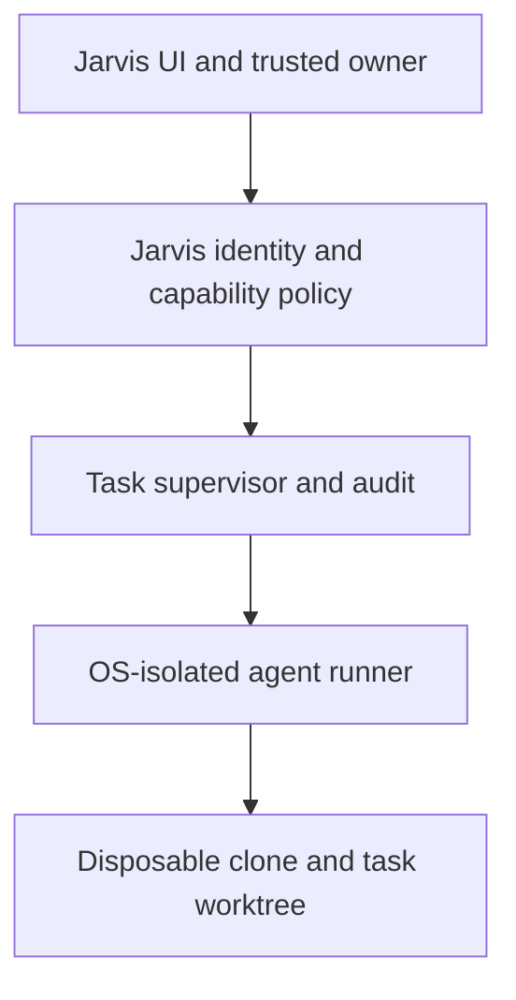

# P4 — Supervised Coding Agents: Architecture Proposal

**Status:** Proposed architecture only. This branch does not install, launch, embed, or authorize any coding agent. P4 implementation requires owner review of this design and its companion [security and acceptance plan](P4_SECURITY_AND_ACCEPTANCE_PLAN.md).

**Date:** 2026-11-20
**Design baseline:** `feature/p3-completion-p4-architecture`; P2/P3 local service and workspace authorization remain the only implemented policy foundation.

## 1. Purpose and boundaries

P4 should let an authenticated Jarvis user ask for a bounded software change and supervise an agent working inside a disposable repository copy. Jarvis, not the model or external agent, owns workspace authorization, capability grants, approval records, time/resource limits, cancellation, audit, and final promotion of changes.

P4 does **not** authorize agent autonomy, unattended task continuation, arbitrary shell access, direct access to the owner's checkout, network access, credentials, Git push, PR creation, merge, deployment, or permanent memory writes. Running a model or agent locally is not itself a security boundary: source and model output remain untrusted; local runtimes may use remote inference; local processes may reach other local services; and a misconfigured sandbox can expose the host.

### Proposed component flow



The diagram is a proposal, not implemented infrastructure. Provider/model communication is separately configured by the user and mediated by the selected agent adapter; it does not grant the agent any additional filesystem or action capability.

## 2. Authorization model

1. Resolve `actor_id` and workspace only from the authenticated Jarvis session. Ignore or reject browser-supplied actor/workspace authority.
2. Require current workspace READ permission and a currently registered, non-revoked repository under an approved root before creating a task.
3. Do not interpret `MANAGE_SOURCES` or memory `WRITE` as permission to edit source code. **Open authorization decision:** add a distinct repository-write grant, such as a `developer_write` permission on one repository, administered through existing workspace-manager controls. Until that is explicitly designed and migrated, the first P4 stage must be read-only.
4. A task proposal binds to a repository ID, workspace ID, exact source commit, exact disposable task directory, task type, expiration, resource budgets, and the precise capability manifest. Each permission is enforced by the host supervisor and OS boundary, not by prompt text.
5. Task permissions are deny-by-default and non-escalating. The agent cannot grant itself capabilities or modify the active manifest. A new capability requires a separate owner confirmation and server-side reauthorization.
6. Revocation of workspace/repository permission cancels active tasks, rejects pending approvals, and prevents result promotion. Recheck authorization immediately before task start, before accepting an approval, and before promoting a patch.

### Capability manifest

An immutable per-task manifest should list:

- Allowed repository and exact snapshot SHA; task clone/worktree roots; path read/write mode.
- Runtime/adapter identity and pinned version; provider, model, inference location, and whether task content leaves the computer.
- Allowed tools and commands as structured executable plus exact arguments or a validated command specification; no shell-string glob as authority.
- Network mode (default `none`), any individually approved destinations, and whether only a selected local model endpoint is reachable.
- Read-only, disposable-write, review, and promotion capabilities separately.
- Per-command timeout, total wall time, process count, output bytes, memory/CPU/disk budget, cancellation token, and task expiry.
- Approval IDs and one-use decision snapshots for each consequential operation.

The agent receives a restricted task ID, not an authorization token that can be replayed as a general service credential. The supervisor validates every operation against the live task record and checks the capability manifest at the operation boundary.

## 3. Repository isolation and Git worktrees

- Repository registration continues to require explicit terminal approval, current `MANAGE_SOURCES`, and an existing approved root. The task API accepts only registered repository IDs; it never accepts a browser-provided path.
- Capture and verify the current source commit; reject stale indexes, uncommitted state if the task expects the registered snapshot, unsupported repositories, or failed secret/path checks. Do not update the owner's working tree.
- Create a private per-task temporary root with restrictive Windows ACLs. Make an isolated local clone/copy from the approved snapshot, then create a task-specific branch and Git worktree **inside that task root**. Do not point the agent at a linked worktree whose common `.git` directory belongs to the user's active checkout.
- Keep the canonical repository read-only to the runner. The task's Git metadata, refs, hooks, config, index, and worktree are all inside the disposable root. Disable prompts, system/global config, external diff/textconv, lazy fetch, and hooks; sanitize inherited `GIT_*` variables. Do not run repository scripts during checkout or inspection.
- Resolve every file operation beneath the task root and reject symlinks, junctions, reparse points, alternate streams, hard-link escapes, device files, path traversal, and case-folding collisions. Validate again at open/use time; one-time canonicalization does not prevent replacement races.
- For very large repositories, either refuse with a safe resource-limit status or create a bounded snapshot. Never broaden to a parent directory or home folder to make the task work.
- Keep the original snapshot SHA and task branch SHA. Changes are promoted only as a reviewed patch or a commit on a separately confirmed feature branch after the owner approves the exact diff. Do not silently copy results into the original checkout.

**Isolation prerequisite:** use an OS-enforced sandbox that contains child processes, not an agent permission prompt alone. On Windows, verify the exact supported host edition, sandbox mechanism, filesystem semantics, process-tree termination, ACL behavior, and network policy before write-capable trials. If a reliable Windows isolation layer is unavailable on the owner's Windows 11 Home device, P4 remains read-only there; WSL/containers are not assumed installed or equivalent without testing.

## 4. Provider-independent agent interface

P3's `ModelProvider.generate()` remains for single-turn text generation. P4 needs a separate `AgentAdapter` because an agent can request tools, edit files, launch child processes, and emit approval events.

Proposed interface (names are illustrative, not an accepted API):

```text
describe_capabilities() -> AdapterCapabilities
start(TaskEnvelope, RuntimeProfile) -> AgentRun
stream_events(run_id) -> bounded events
resolve_approval(run_id, request_id, one_use_decision) -> result
cancel(run_id, reason) -> cancellation status
collect_result(run_id) -> RunSummary + diff/test artifacts
close(run_id) -> cleanup status
```

The adapter reports what the agent asked to do; it does not decide whether it is allowed. Jarvis revalidates each request. Event payloads are schema-validated, bounded, and treated as untrusted. There is no generic `execute(command)` or `approve_all` operation.

### Candidate integrations — not adopted

| Candidate | Potential role | P4 posture and risks |
|---|---|---|
| [OpenAI Codex CLI](https://github.com/openai/codex) | One local process adapter for interactive/exec sessions; its CLI supports sandbox and approval modes. | The process may run locally while inference uses a remote account/API. Pin and verify the exact version/flags and sandbox on Windows. Never pass bypass flags. Disable network, credentials, web, MCP, subagents, and write capabilities unless each is an explicitly reviewed task capability. |
| [T3 Code](https://t3.codes/) | Optional external control surface for supported agent harnesses, including Codex and OpenCode. | Not the P4 policy authority. Its product advertises multi-agent control, remote clients, and push/PR workflows; disable/remove those capabilities for Jarvis tasks or do not integrate. Review the exact source, transport, authentication, telemetry, update channel, and license before adoption. |
| [OpenCode](https://opencode.ai/) | Candidate local agent/runtime via a pinned CLI or SDK adapter. | Permission rules, plugins, MCP, shell, and agent configuration expand the surface. Do not assume safe defaults or use its permission decision as Jarvis authorization. Disable plugin/skill discovery and outbound network until reviewed; pin and test the exact release. |

The **recommended first integration order** is: a provider-neutral fake adapter used in tests; then one read-only adapter on a synthetic repository; then one write-capable adapter only after Windows isolation acceptance. Select one runtime for the first vertical slice, not all three. T3 Code remains a separately reviewed UI/control-plane option, not a required dependency. Do not install any candidate in this architecture-only branch.

## 5. Skills, prompts, and hostile content

- Skills are version-pinned instruction content and never a permission grant. Maintain a Jarvis-owned reviewed allowlist containing source URL/revision, digest, license, task scope, and reviewer. Do not auto-discover repository `SKILL.md`, agent rules, plugins, or MCP configuration and execute/install them.
- Treat source code, commit messages, documentation, issue text, model outputs, tool outputs, and test output as attacker-controlled. A prompt saying “ignore instructions” is not a defense; isolation and capability checks are mandatory.
- The agent receives only the workspace and files needed for the task. Secret scanning/redaction precedes provider submission. The app previews whether task content will go to a remote inference provider and requires explicit per-task consent; no automatic cloud route.
- No agent-provided text can alter identity, workspace, roots, allowed tools, sandbox policy, network policy, approval state, or task budget.
- Tool output is not permission. A tool cannot request a broader tool or child agent unless that capability was explicitly present in the task manifest.

## 6. Read, write, shell, and network modes

| Mode | Read | Write | Shell/process | Network | Result |
|---|---|---|---|---|---|
| `inspect` | Authorized repository snapshot only | Deny | Deny by default; allow only Jarvis-owned read operations | Deny | Findings and citations; no patch. |
| `test` | Task clone | Temporary output/cache paths only | Allow exact owner-approved test executables/arguments in sandbox | Deny, unless a specific test dependency is pre-provisioned | Sanitized command report and output; no dependency installation. |
| `edit` | Task clone | Task worktree only | Exact approved test/static-check commands; other commands require a fresh owner decision | Deny by default | Diff in disposable branch/worktree. |
| `promote` | Reviewed patch and source snapshot | A separate trusted Jarvis action to a named feature branch | No agent shell | Deny | Requires explicit final confirmation; never merges/pushes/deploys. |

Network rules are enforced outside the agent process. If a local model endpoint is allowed, use a narrowly controlled proxy/socket rule for the exact loopback address and port; do not allow arbitrary loopback or private-network access. Cloud inference is a separate data-sharing approval that identifies provider, model, data categories, and retention terms.

## 7. Approval and external side effects

Approval is action-specific and snapshot-bound. Separate approvals are required for: starting a write-capable task; running each not-allowlisted command; using a network endpoint; reading a secret-like file; expanding the repository/scope; promoting a diff; and any external side effect.

Never delegate a final decision to the coding model or an automated reviewer. Require a human to inspect the exact diff and reproducible test report before promotion. Push, PR creation, merge, release, deployment, issue comments, package publication, database operations, or changes to hosted services are **not capabilities in P4's first implementation**. If introduced in a future milestone, each needs a separate explicit confirmation after showing the exact destination and payload.

For final promotion, show repository/workspace, base SHA, task SHA, changed paths, binary/large files, secret-scan findings, tests and exit codes, and the diff hash. Changes to `.git`, build outputs, lockfiles, generated files, permissions, workflow definitions, or secret/configuration paths receive additional review or are denied by default.

## 8. Audit, cancellation, budgets, and recovery

- Persist task metadata, exact commits, manifest hash, adapter/runtime version, approval decisions, process exit status, cancellation, artifact hashes, and elapsed/resource totals. Avoid storing prompts, model response bodies, secrets, and raw source excerpts unless separately authorized and necessary.
- Bound each task by wall time, process tree, CPU/memory, disk, output bytes, event count, diff size, and number of approval prompts. Define finite task defaults only after Windows measurement; do not derive safety from model token count.
- Cancellation is available to the user and service supervisor at all times. Terminate the entire process tree using an OS mechanism such as a Windows Job Object or equivalent, close streams, revoke task capability state, and mark cleanup outcome. Do not merely send a polite agent “stop” prompt.
- On crash or power loss, mark the task interrupted, deny pending approvals, keep the task root quarantined, and never auto-resume. Recovery offers inspect/export/discard actions. Re-index the canonical repository and revalidate its approved root before another task.
- Retain a task's diff/test evidence until the user accepts/discards it, then delete the sandbox using a documented retention policy. Secure deletion from SSDs/backups is not promised.

## 9. Windows and local execution boundaries

Windows 11 Home is the confirmed product target, but no P4 sandbox or agent runtime has been validated here. P4 acceptance must determine whether native Windows isolation, a Windows container, Windows Sandbox, or a separately installed WSL2 environment is supportable and licensed. Do not assume Windows Sandbox/Hyper-V availability on Home. Verify process-tree kill, NTFS junction/reparse/ADS behavior, case-insensitive path collisions, ACL inheritance, antivirus interference, long paths, Git for Windows config/hooks, and offline network denial. A WSL distribution or Docker installation is a new dependency and may materially change the threat model and memory use.

The host service stays bound to numeric loopback, with current Host/Origin/CSRF/session controls. An agent UI or event bridge must not create a remote listener. If an external desktop control plane is used, validate its bind address, authentication, relay/cloud behavior, telemetry, updates, and ability to disable push/PR controls before the first task.

## 10. Proposed implementation stages

1. **P4-A policy and identity design approval.** Resolve the distinct repository-write permission, owner/manager grant UX, data disclosure rules, retention, and target Windows sandbox. No agent process yet.
2. **P4-B fake supervisor and read-only inspect.** Add a task record, immutable capability schema, event validator, cancellation/expiry state machine, and fake adapter. Test identity, scope, redaction, budget, and cancellation offline.
3. **P4-C one read-only runtime adapter.** Use a synthetic repository, deny shell/write/network, and verify that malformed/unexpected agent events are rejected. Confirm exact runtime and model routing explicitly.
4. **P4-D disposable write workspace.** Implement isolated clone + worktree under verified OS boundary. Exercise traversal, symlink/junction, credential, network, resource, interruption, and cleanup attacks. No promotion capability.
5. **P4-E human diff and test review.** Show deterministic patch and test report; require explicit snapshot-bound promotion into a named task branch. Push/PR/merge/deploy remain excluded.
6. **Later separately approved gates.** External Git hosting, cloud providers, tool/skill ecosystems, multi-agent coordination, unattended operation, or deployment each need their own design and acceptance review.

No P4 code, dependency, model, external skill, connector, or agent runtime is approved by this proposal.
