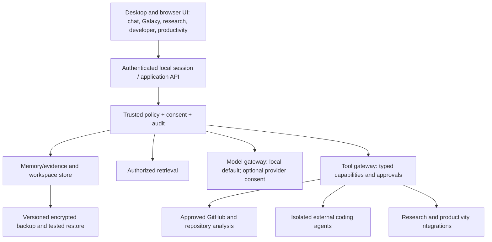

# Jarvis 2.0 — Product & Architecture Baseline (Proposal)

**Date:** 2026-11-18  
**Status:** Proposed for owner review; this document is not acceptance of any implementation.  
**Source of decisions:** Five-round, 30-question owner discovery conducted on 2026-11-18.  
**Baseline checked:** `main` at `97d0be3f03623cdfea6916af3f931192f2ea0a08`.  
**Rule:** This file does not grant new tool capabilities, repository access, or merge/deploy permission.

## Product purpose

A unified local-first AI operating companion: one trustworthy memory/evidence platform supporting independent **Developer**, **Research**, and **Productivity** modules. It should work offline for core storage/retrieval, support Arabic and English, and allow optional, explicitly controlled external models and connectors. The Knowledge Galaxy presents real evidence-backed relationships; it is not the system of record.

## Discovery decisions — all proposed

| ID | Decision | Guardrail |
|---|---|---|
| ADR-01 | Hybrid memory: shared personal layer and separate project workspaces | Cross-workspace content is denied until an explicit, scoped grant |
| ADR-02 | Identify useful memory candidates automatically | Durable writes require authenticated human approval |
| ADR-03 | Context-aware source retrieval | Privacy/authorization precedes relevance or freshness |
| ADR-04 | Local models by default; optional cloud | Disclosure of context to external provider needs consent |
| ADR-05 | Adaptive single-/multi-agent orchestration | No unbounded delegation |
| ADR-06 | Adaptive conversational/engineering persona | Style does not change permissions |
| ADR-07 | Progressive repository reverse engineering | Read-only static inventory by default; no untrusted execution |
| ADR-08 | Supervised coding | Isolated worktrees, separate high-risk approvals, no unapproved merge |
| ADR-09 | Hybrid internal intelligence and external coding agents | Every agent shares common permission contract |
| ADR-10 | Evidence-backed persistent repository intelligence | Findings tied to commit, paths, evidence, expiration rules |
| ADR-11 | Dependency-aware parallel work | Independent task owners, explicit interfaces, integration reviews |
| ADR-12 | Interactive repository intelligence workspace | Clickable, cited, accessible 2D fallback |
| ADR-13 | Reproducible research laboratory | Version datasets/environments/runs; control execution resources |
| ADR-14 | Proactive productivity suggestions | Suggestions are not actions, honor quiet hours |
| ADR-15 | Adaptive 3D knowledge + practical panels | 3D optional, no visual-only control path |
| ADR-16 | Optional local wake word | Push-to-talk default, visible microphone state |
| ADR-17 | Unified adaptive interface | Shared UI shell, specialized task views |
| ADR-18 | Controlled adaptive personalization | Reversible proposed preferences, no silent privileged expansion |
| ADR-19 | Risk-based capability permission model | Enforced by trusted core, not model text |
| ADR-20 | Layered local data protection | Protected secrets, scoped stores, retention and backups |
| ADR-21 | Bounded mission contracts | Explicit goal, tools, scope, budget, stop conditions |
| ADR-22 | Verified checkpoints and recovery | Some external actions cannot be undone |
| ADR-23 | Scoped connector access | Separate read/write/share/execute capabilities |
| ADR-24 | Encrypted versioned backup and optional sync | Test restore and recovery-key procedures |
| ADR-25 | Modular local-first core | Prefer modular monolith over premature microservices |
| ADR-26 | Runtime-independent model interfaces | Ollama first; LM Studio/cloud are unverified adapters |
| ADR-27 | Curated versioned skills registry | Skills are instructions, not security enforcement |
| ADR-28 | Central tool gateway | API, MCP, CLI adapters all pass authorization |
| ADR-29 | GitHub-centered engineering coordination | Reproducible handoffs, independent review, owner merge approval |
| ADR-30 | Foundation-first vertical slices | Stabilize local chat and trust boundaries before autonomy |

## Candidate modular architecture (not fully implemented)

**Separation:** presentation and model planning are untrusted; authoritative permission checks live in the application service. Retrieval cannot cross a workspace boundary based on model instructions. Skill activation never adds capability grants.

**Proposed stack:** Python modular core, SQLite/FTS5 current base, TypeScript shared UI, conditional Tauri 2 desktop shell, existing vendored Three.js synthetic prototype, Ollama current adapter, LM Studio adapter candidate, later MCP/Playwright/REA after separate reviews. Model weights, graph stores, vector indexes and native tools are not presumed installed.

## Verified against repository / limitations

- `main` contains `jarvis_core/storage.py`, `ingestion.py`, `retrieval.py`, `memory.py`, `ollama.py`, `rag.py`, evaluations/tests, and `prototypes/m03_a`.
- M01 and M02 acceptance/evaluation details are recorded in existing docs; do not convert their historical claims into new test results.
- PR #13 (M03-A) is **merged**. Existing docs saying 'under review' are stale.
- PR #14 (M03-B1) is **open/draft and unmerged** at `6cb0635eaa2455b31f4b9e7bff2dde1399dd8e4d`; it contains 13 changed paths. Live local chat requires new-laptop verification.
- M01 documentation explicitly notes that consent-based cross-workspace aggregation is missing; browser session/user approval proof is also incomplete.
- The original hardware references in `docs/PROJECT_SPEC.md` describe the **old MX450 laptop** and must not be mistaken for current verification.
- This baseline was inspected remotely through GitHub; it does **not** verify a local working tree, runtime installation or GPU/model throughput.

## Unresolved decisions / acceptance gates

1. Authenticate desktop and loopback-browser sessions; bind signed memory approval to a real human decision and exact snapshot.
2. Cross-workspace consent: scope, expiration, revocation, audit receipt, and search UI.
3. Categorize memories: ephemeral, candidate, approved, archived, deleted; define duplicate/conflict resolution and retention.
4. Define cloud data-sharing policy, provider secrets handling, cost ceilings, and prompt/tool argument redaction.
5. Confirm single-user first release and threat model for other local processes, browser origins, hostile repository content and prompt injection.
6. Specify Windows worktree/agent sandbox and filesystem, process and outbound network limits before executing unknown repositories.
7. Define encrypted backups, recovery keys, purge semantics versus retained backups, versioned migrations and restore drills.
8. Define observable Arabic/English retrieval metrics and commit-aware repository freshness rules.
9. Establish representative datasets, latency targets, battery/power and memory budgets on new hardware.
10. Audit code-level implementation and tests before any claims of deployment readiness.

## Work order (gated vertical slices)

| Order | Slice | Demo / exit evidence |
|---|---|---|
| P0 | Documentation truth, risk register, curated skills, new-machine inventory | Owner-reviewed baseline and reproducible local status |
| P1 | M03-B1 live local-chat closure | Real answer returned, secure pairing, latency/error logs, targeted+regression tests, owner decision on draft PR |
| P2 | Authenticated workspace/evidence chat + human memory approvals | Denied unauthorized paths, reviewed permanent memory, evidence citations, tested restore |
| P3 | Read-only repository intelligence | Commit-pinned file/module map, architecture citations, no untrusted execution |
| P4 | Reviewed skills + permitted development agents | Bounded worktrees, separate reviewer, owner-only merges |
| P5 | Research laboratory and productivity vertical slices | Reproducible experiments and scoped connector approvals |
| P6 | Voice, responsive Galaxy graph, mission orchestration | Accessible fallback, explicit activation, recovery/stop tests |

Parallelization allowed only when contracts are stable. Each task records ID, source branch/SHA, owner, permitted files/tools, expected tests, captured evidence, and review/merge gate.

## Immediate non-destructive new-laptop inspection

On the owner's new Windows laptop, confirm `git status --short --branch`, active checkout SHA, Python and Node versions, driver/CUDA-visible VRAM, actual RAM/disk, running Ollama/LM Studio endpoints, and model inventory. Do not paste tokens or `.env`. Benchmark with a small approved prompt/data fixture and report cold/warm latency, VRAM/RAM use and errors; do not infer performance from GPU model name.

## Required documents to reconcile after baseline approval

`README.md`, `docs/PROJECT_SPEC.md`, `docs/ARCHITECTURE.md`, `docs/ROADMAP.md`, `docs/DECISIONS.md`, `docs/OPEN_SOURCE_STACK.md`, `docs/M01_ACCEPTANCE.md`, plus review of PR #14. Resolve contradictory milestone statuses without overwriting historical acceptance evidence.

## Change-control

This is a **documentation-only proposed baseline** on a separate branch. No executable source, model, secrets, dependencies, `main` branch or draft PR #14 are modified. Every later implementation and merge needs separate owner-approved scope.
